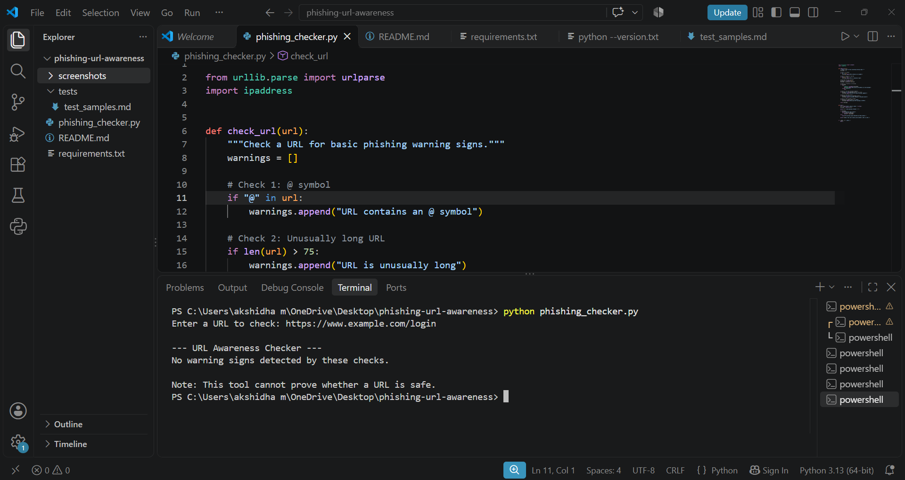

# EWB Phishing URL Awareness Checker

## Project Description

The EWB Phishing URL Awareness Checker is a beginner-friendly Python project that checks URLs for common phishing warning signs.

It analyzes the URL text and displays warnings when certain suspicious patterns are detected.

## Features

- Detects the `@` symbol in a URL.
- Checks whether a URL is longer than 75 characters.
- Detects an IP address used as the hostname.
- Checks for five or more hostname segments.
- Detects the `xn--` Punycode marker.
- Warns when a URL uses HTTP instead of HTTPS.

## Technologies Used

- Python
- VS Code
- Python standard libraries: `urllib.parse` and `ipaddress`

## How to Run

1. Install Python on your computer.
2. Open the project folder in VS Code.
3. Open the VS Code terminal.
4. Run the following command:

   ```bash
   python phishing_checker.py
   ```

5. Enter a URL when prompted.
6. Read the warning signs displayed by the program.

## Example

**Input:**

```text
https://www.example.com/login
```

**Expected output:**

```text
--- URL Awareness Checker ---
No warning signs detected by these checks.

Note: This tool cannot prove whether a URL is safe.
```

## Testing

The program was tested using five sample URLs from the project workbook. The tests covered normal URLs, IP addresses as hostnames, the `@` symbol, multiple hostname segments, and Punycode.

The observed results were checked against the expected warning signs.

Detailed test results are available in [tests/test_samples.md](tests/test_samples.md).

## Screenshots

### Sample Run



### Test Results


## Future Improvements

## Implemented Improvements

1. **Repeated URL Checking:** The program allows users to check multiple URLs in one session and exit by typing `quit`.
2. **Warning Explanations:** Each detected warning includes a simple explanation to help users understand the possible risk.

## Limitations

This tool checks basic warning signs only. It does not visit websites or connect to the internet, and it cannot guarantee that a URL is safe.

## Ethical Use

This project is intended for cybersecurity education and phishing awareness.

## Disclaimer

A URL with no detected warning signs is not guaranteed to be safe.
