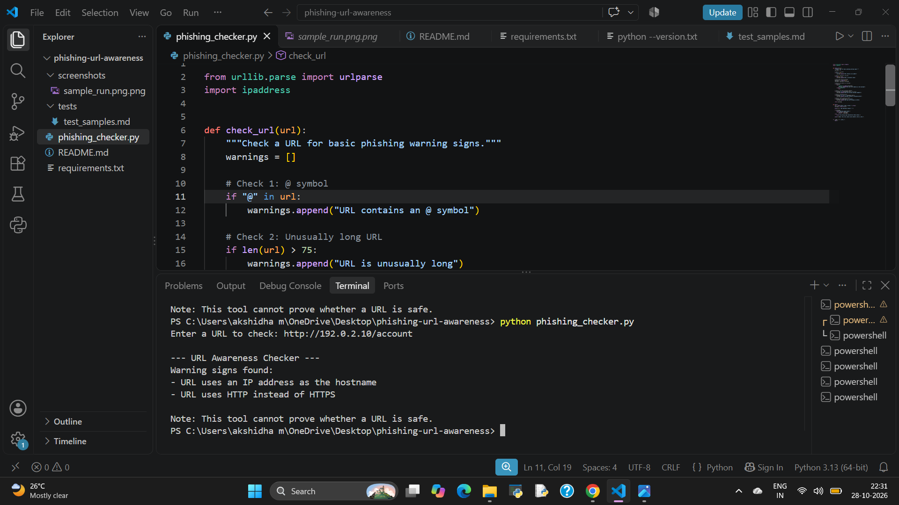

# Phishing URL Awareness Checker

## Project Overview

The Phishing URL Awareness Checker is a beginner-friendly Python project that identifies basic warning signs in a URL. It helps users understand suspicious URL characteristics and promotes cybersecurity awareness.

## Features

The program checks for six basic warning signs:

1. Presence of an `@` symbol.
2. URL length greater than 100 characters.
3. IP address used as the hostname.
4. Five or more hostname segments.
5. Presence of a Punycode marker (`xn--`).
6. Use of HTTP instead of HTTPS.

## Implemented Improvements

1. **Repeated URL Checking:** Users can check multiple URLs in one session and exit by typing `quit`.
2. **Warning Explanations:** Each detected warning includes a simple explanation to help users understand the possible risk.

## Technologies Used

- Python
- VS Code

## Requirements

- Python 3 installed.
- No external Python packages required. The project uses Python's built-in libraries.

## How to Run

1. Download or clone this repository.
2. Open the project folder in VS Code.
3. Open the terminal.
4. Run the following command:

```bash
python phishing_checker.py
```

5. Enter a URL when prompted.
6. Type `quit` to exit the program.

## Example Output

```text
--- URL Awareness Checker ---
Type 'quit' to exit.

Enter a URL to check: http://192.0.2.10/account

Warning signs found:
- URL uses an IP address as the hostname
  Explanation: The website uses a numerical address instead of a domain name.
- URL uses HTTP instead of HTTPS
  Explanation: The connection does not use HTTPS encryption.

Note: This tool cannot prove whether a URL is safe.
```

## Testing

Five original sample tests and four additional feature tests are documented in `tests/test_samples.md`.

The test document includes expected results and recorded statuses.

## Screenshots

### Sample Run


### Test Results



## Limitations

- This tool checks basic URL warning signs only.
- It does not open URLs or connect to the internet.
- It cannot prove whether a URL is safe or malicious.
- A URL with no detected warning signs may still be unsafe.

## Ethical Use

This project is intended for educational purposes and cybersecurity awareness. It should not be used as a replacement for professional security tools.

## Conclusion

The Phishing URL Awareness Checker demonstrates basic Python programming concepts and introduces users to common phishing URL warning signs.
